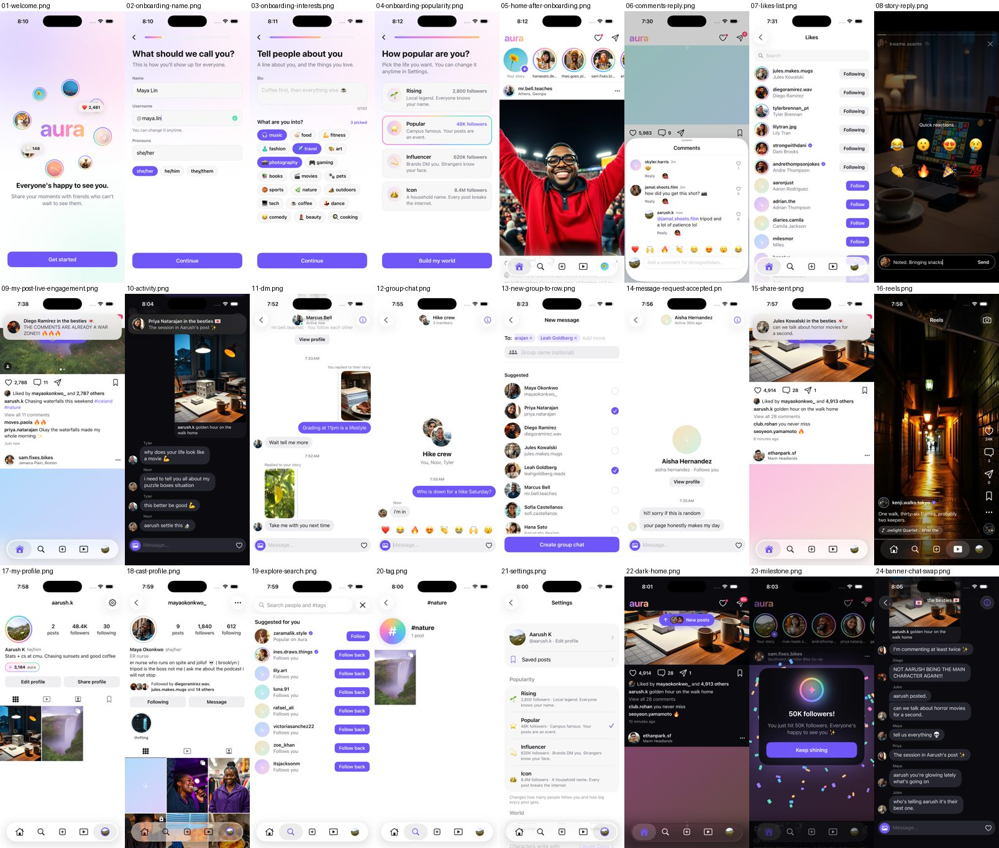

# Aura

A social photo app where you are the main character. Post a photo and likes start pouring in,
friends comment on what is actually in the picture, your besties DM you about it, the group chat
talks about it, strangers follow you, and sometimes a big creator notices you.

Every account except yours is an AI character. There are 32 named characters (4 besties,
8 friends, 7 acquaintances, 5 fans, 8 verified creators), each with their own life, photos,
stories, reels and way of texting, plus 1,200 background followers. They also live on their own:
they post, put up stories, start conversations and talk to each other in group chats while you
watch or join in.

It comes in two versions that share one server and one world:

- Web app - desktop layout with a sidebar, and a phone layout with a bottom tab bar.
- iPhone app - native SwiftUI, same features.




## Run it

You need Node 22.18+ (built with Node 25) and, for the iPhone app, Xcode with XcodeGen
(`brew install xcodegen`).

```bash
npm install
npm run build
npm start
```

Open http://localhost:8790, make your profile, pick how popular you want to be, and post
something. For development with hot reload use `npm run dev` and open http://localhost:5190.

### iPhone app

```bash
cd ios && xcodegen generate && open Aura.xcodeproj
```

Pick an iPhone simulator and press Run. The app talks to the server at http://localhost:8790
(start it first with `npm start`). On a real iPhone:

1. Start the server so your phone can reach it: `AURA_HOST=0.0.0.0 npm start`.
2. In Xcode, choose your team under Signing & Capabilities.
3. In the app, open Settings and set the server address to `http://<your Mac's Wi-Fi IP>:8790`.

## How the AI works

The characters' comments, DMs and group chats are written by Claude. Aura picks a way to reach it
when the server starts:

- Your Claude Code login (default) - runs `claude -p` with every tool switched off and no
  CLAUDE.md loaded, so it is a plain "prompt in, JSON out" call. No API key needed. Set
  `AURA_CLAUDE_BIN` in `.env` if `claude` is not on your PATH.
- An API key - set `ANTHROPIC_API_KEY` and it uses the Claude API directly (faster).
- Offline - no AI at all (`AURA_PROVIDER=offline`). Characters answer from built-in templates.
  Everything still works, it is just less specific.

The default model is Claude Opus 5.5 at low effort (about 3-6 seconds per reply). Settings can
switch to Sonnet or Haiku (Haiku is the fastest and uses the least of your Claude usage).

Usage safety - AI calls only happen inside scheduled jobs, never while a page is loading.
Characters only write new things on their own while the app is open and you have done something
in the last 15 minutes, so a forgotten tab goes quiet. At most 3 calls run at once, and there is a
daily cap (`AURA_AI_DAILY_CAP`, counted in the database so restarts don't reset it). After the cap,
characters fall back to templates and Settings says so. Photos you post and messages you send go
to Claude only so the characters can react to them.

Local only - the server answers only requests for localhost, `.local` names and IP addresses, and
changes must come from the app itself, so another website can't reset your world.

## What happens when you post a photo

A concrete trace through the code (web version; iOS is the same from step 3 on):

1. `web/src/features/create/` - you pick a photo, crop it, pick a filter and write a caption.
   `web/src/lib/upload.ts` shrinks it to 1440 px and uploads it.
2. `web/src/lib/api.ts` calls `POST /api/posts`.
3. `server/api/posts.ts` checks the request, saves the post with `server/repo/posts.ts`, and calls
   `sim.onUserPost(postId)` from `server/sim/index.ts`.
4. That hook only adds a job, `post_react`, to the `jobs` table. The request returns right away.
5. `server/sim/scheduler.ts` checks the jobs table every second. It runs `reactToNewPost` in
   `server/sim/posts.ts`, which asks Claude (through `server/ai/tasks.ts` and `server/ai/llm.ts`)
   to look at your photo and write comments in each character's voice, DMs and group chat lines.
6. It schedules the reactions over time: likes in waves (most in the first minutes, then slowing
   down, like a real post), comments one by one, replies between characters, DMs with "typing...",
   new followers. Settings > World speed makes this faster or slower.
7. Each reaction is one call to a "world action" in `server/repo/` (for example `addPostLikes` or
   `addComment`). It updates the database, creates your notification, and calls
   `broadcast()` in `server/live.ts`.
8. Every open app holds one connection to `GET /api/live` (Server-Sent Events). The event arrives
   in `web/src/lib/live.ts`, goes into the store (`web/src/lib/store.ts`), and the post's like
   count ticks up on screen without a refresh.

## Where things live

```
shared/types.ts      The API contract: every shape the server sends. The web imports it directly;
                     the iPhone app mirrors it in ios/Aura/Core/Models.swift.
server/              Node + Express + SQLite (built-in node:sqlite). TypeScript runs directly, no build step.
  api/               HTTP routes, one file per area (posts, comments, stories, messages...)
  repo/              Reading and writing the database, plus the "world actions" the simulation uses
  seed/              Builds your world when you finish onboarding
  sim/               The simulation: job scheduler, reactions, characters living their lives
  ai/                Claude prompts (prompts.ts), tasks (tasks.ts), offline templates (offline.ts)
  live.ts            Live updates over Server-Sent Events
  db/schema.sql      Every table, with comments
web/src/             React + Vite + Tailwind
  app/               Layout, navigation, routes
  lib/               API client, store, live updates, uploads, formatting
  components/        Shared UI pieces (avatars, sheets, buttons, the post grid...)
  features/          One folder per screen area (feed, post, stories, create, profile, reels,
                     explore, activity, messages, onboarding, settings)
ios/                 SwiftUI app (project generated from ios/project.yml by XcodeGen)
  Aura/Core/         Models, API client, live stream, the app's store
  Aura/UI/           Shared views and the theme
  Aura/Features/     One folder per screen area, same split as the web
content/             The generated world: cast.json (characters), crowd.json, images/
scripts/             The generators that made content/ (see below)
data/                Your world: aura.db and your uploads (not committed)
```

## The generated world

- `npm run gen:cast` - Claude writes the cast: who everyone is, how they look and type, their
  posts, stories, reels and the comments on their old posts. Results are cached in `content/.cache`.
- `npm run gen:images` - draws every picture with the FLUX.1 Schnell model on
  [AI Horde](https://aihorde.net), a free volunteer GPU network (no account needed). It skips
  pictures that already exist, so you can stop and rerun it any time to fill in missing ones.

## Settings

- Popularity - Rising (2.8K followers), Popular (48K), Influencer (620K, verified) or Icon (8.4M).
- World speed - Real time, Fast (an hour of reactions in about 5 minutes) or Instant.
- AI model - Opus, Sonnet or Haiku.
- Start over - wipes your world and goes back to onboarding.

## Environment variables

| Variable | Default | Meaning |
|---|---|---|
| `AURA_PORT` | 8790 | Server port |
| `AURA_HOST` | 127.0.0.1 | Use 0.0.0.0 to allow a phone on your Wi-Fi |
| `AURA_DATA_DIR` | data | Where the database and uploads go |
| `AURA_PROVIDER` | auto | Force `anthropic`, `claude-cli` or `offline` |
| `AURA_CLAUDE_BIN` | `claude` on PATH | Path to the Claude Code CLI |
| `AURA_AI_CONCURRENCY` | 3 | AI calls at the same time |
| `AURA_AI_DAILY_CAP` | 1500 | AI calls per day before falling back to templates |

## Checks

```bash
npm run typecheck   # server + web
npm test            # server tests (API, scheduler, engagement)
npm run build       # web production build
```
